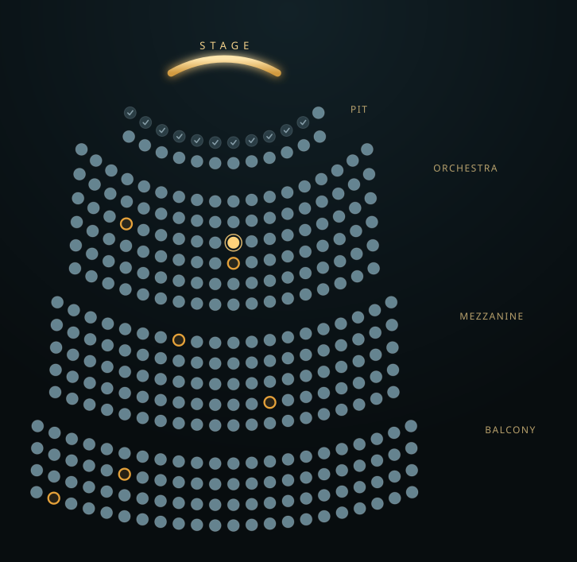
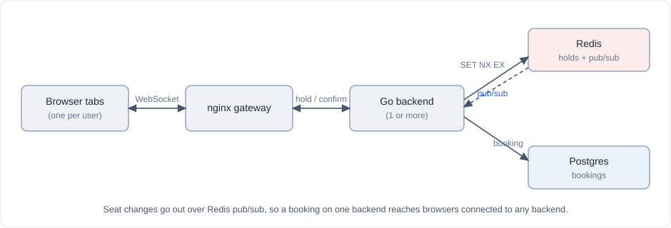

# GrabSeat

[](https://github.com/vppatel4/GrabSeat/actions/workflows/ci.yml)

GrabSeat is a small seat-booking app I built to work through one tricky problem:
what happens when a lot of people try to grab the same seat at the same time.

When a show goes on sale, two people can click the same seat in the same second.
The app has to make sure only one of them actually gets it, tell the other one
right away that it's taken, and never sell the same seat twice. On top of that,
everyone looking at the seat map should see it update live.

There's no login. When you open the app you get a random id for that browser tab,
and that's enough to pick seats. If you open a second tab, that's a second
"person", so you can race yourself for the same seat and watch one tab win. You
only need Docker to run it.



This is the seat map. Grey seats are open, gold is the seat you're holding, amber
means someone else is holding it, and a check mark means it's already booked. I'll
add a short screen recording here later (notes are in [docs/DEMO.md](docs/DEMO.md)).

## How it stops the same seat from being booked twice

There are only three seat states: open, held, and booked. The rule is simple: a
seat can be booked by one person only. I use two databases for two different jobs
to make that happen.

**Redis** keeps track of who is currently holding a seat. Holding a seat is one
Redis command: `SET seat NX EX`. `NX` means "only set this if it isn't already
set", and `EX` means "delete it on its own after a few minutes". So if two people
try to hold the same seat at once, Redis lets only one of them through. And
because the key deletes itself, a hold that nobody finishes just disappears, I
don't need a background job to clean it up.

**Postgres** stores the bookings that are final. The bookings table has a `UNIQUE`
rule on the seat, so the database itself won't allow two bookings for the same
seat even if something went wrong in the code.

So Redis handles the fast "who grabbed it first" part, and Postgres is the backup
that makes a double booking impossible.

## How it's put together



The browser talks to an nginx gateway, and the gateway passes the request to a Go
backend. The backend uses Redis for holds and Postgres for bookings. When a seat
changes, the backend sends the update through Redis pub/sub, so if I run more than
one backend, a booking made on one backend still reaches people connected to a
different one.

Here's the order of things when two people click the same seat:

1. Both browsers send a "hold seat 42" request to the backend.
2. The backend runs `SET hold:42 ... NX EX` for each. Redis lets the first one win
   and rejects the second.
3. The winner gets "held, you have a few minutes". The other one gets back a
   "someone grabbed it first" message right away.
4. The backend publishes the change to Redis, and every browser's seat map turns
   that seat amber.
5. When the winner clicks confirm, the backend writes the booking to Postgres and
   the seat shows as booked for everyone.

There's a bit more reasoning behind these choices in
[docs/ARCHITECTURE.md](docs/ARCHITECTURE.md).

## What I used

| Part | Tech | What it does |
|---|---|---|
| Backend | Go | HTTP + WebSocket server, holds, bookings |
| Holds + live updates | Redis | Atomic seat holds and pub/sub for broadcasting changes |
| Database | PostgreSQL | Stores confirmed bookings and the seat/event data |
| Live updates | WebSockets | Pushes seat changes to the browser without polling |
| Frontend | Next.js + TypeScript + Tailwind | The seat map, hold timer, and confirm button |
| Gateway | nginx | Sits in front so I can run more than one backend |
| Load testing | k6 | Throws lots of traffic at it to get real numbers |
| Logging/tracing | slog + OpenTelemetry | Follow one booking from start to finish in the logs |
| Rate limiting | Per-session limit | Slows down one client hammering the API |
| Tests | Go test + k6 | Unit tests and the concurrency tests |
| CI | GitHub Actions | Runs the tests on every push |
| Running it | Docker + Docker Compose | Start everything with one command |

## Walking through a booking

1. You open the app. Your tab gets a random id and opens a WebSocket. The first
   thing the server sends back is the current state of every seat, so the page
   always starts correct.
2. You click an open seat. The browser asks the backend to hold it. If you win the
   Redis hold, the seat is yours for a few minutes; if not, you get told right away
   it's taken.
3. The backend sends the "held" update through Redis, and every open seat map shows
   that seat as held.
4. You click confirm. The backend saves the booking in Postgres with
   `INSERT ... ON CONFLICT DO NOTHING`. That one line means if the same confirm is
   sent twice (a double click or a retry), it still only books once and doesn't
   error. Then the seat shows as booked everywhere.
5. If you don't confirm in time, the Redis hold expires on its own, the backend
   hears about it, and the seat goes back to open for everyone.

## Running it

You need Docker Desktop. Nothing else, no accounts.

**Windows (PowerShell):**

```powershell
copy .env.example .env
docker compose up -d --build
docker compose ps
```

**macOS / Linux:**

```bash
cp .env.example .env
docker compose up -d --build
docker compose ps
```

Then open **http://localhost:3000**.

| Service | URL / port |
|---|---|
| Frontend (seat map) | http://localhost:3000 |
| Backend gateway (API + WebSocket) | http://localhost:8080 |
| Postgres | localhost:5432 |
| Redis | localhost:6379 |

Stop it: `docker compose down`
Reset it (wipe the database and all bookings): `docker compose down -v`

To run two backends behind the gateway:

```bash
docker compose up -d --build --scale backend=2
```

If a port is already being used on your machine, change it in `.env` (like
`BACKEND_PORT` or `FRONTEND_PORT`) and start it again.

## Try the race yourself

1. Open **http://localhost:3000** in two browser tabs side by side.
2. Click the same open seat in both tabs at about the same time.
3. One tab turns the seat gold (your hold). The other gets a message that someone
   grabbed it first and shows the seat as held.
4. In the tab that won, click **Confirm booking**. The seat shows as booked in both
   tabs.
5. Or just wait: let the hold timer run out and watch the seat go back to open in
   both tabs.

## Tests and the numbers I got

The tests live in [`loadtest/`](loadtest/). They cover the race condition,
retries, the moment a hold expires, dropping and reconnecting the WebSocket, rate
limiting, Redis going down and coming back, and updates crossing between two
backends. How to run each one is in [loadtest/README.md](loadtest/README.md).

**Concurrency test** (`TestConcurrencyStress`) — 220 requests go for 10 seats at
once:

- 10 holds win, 210 get a clean rejection, and there are **0 double bookings**
- each winner then confirms, and the database ends up with exactly 10 bookings
- hold latency: about **p50 67 ms, p95 78 ms**

**k6 load test** (`loadtest/stress_test.js`) — 80 users hammering the hold endpoint
over a 40-second run:

- about **243,000 requests** at roughly **6,000 per second**
- latency around **avg 11 ms, p95 18 ms**
- **0 server errors**

**k6 double-booking test** (`loadtest/k6_double_booking.js`) — this one actually
books seats: around 50 users all try to hold and confirm the same 25 seats at once,
and then it checks the database:

- about **130,000 hold+confirm requests** against 25 seats
- **exactly 25 confirmations succeeded** (one per seat); the rest were rejected
- afterward the database shows total bookings equals distinct seats, so **0 double
  bookings** (the test checks this itself at the end)
- **0 server errors**, about 5,000 requests/second

These are from running it on my machine with Docker Desktop (Windows 11). The exact
numbers will change on different hardware, but the result is the same: it stays
fast and never double-books.

## Logging and tracing

Every request gets a trace id that shows up in the logs, and the hold and confirm
steps are wrapped in OpenTelemetry spans. With `OTEL_TRACES_EXPORTER=stdout` (the
default) you can run `docker compose logs -f backend` and follow a single booking
through the logs and see how long each step took. Set it to `none` if you want
quiet logs during a load test.

## What I'd do next

- **Snapshot cost.** Every new WebSocket connection builds its seat snapshot by
  reading Redis and Postgres. That's fine for one show. For many shows at once I'd
  cache the snapshot per event.
- **Rate limiting is per backend.** Each backend keeps its own counters, so with
  more backends the real limit goes up. Moving the counter into Redis would fix
  that.
- **No waiting room.** For a really big on-sale I'd put a queue in front so people
  come in waves instead of all hitting the hold endpoint at once.
- **Next.js 14.** A couple of npm audit warnings are only fixed in Next 16. The app
  doesn't use the affected parts, but upgrading would be a clean next step.
- **One event.** The tables support many events; I kept the app on one to keep the
  focus on the concurrency part.

## Folders

```
backend/    Go service (holds, bookings, websocket, logging, api)
frontend/   Next.js seat map
loadtest/   The tests and k6 scripts
gateway/    nginx config for running more than one backend
docs/        ARCHITECTURE, DEPLOYMENT, DEMO
```
